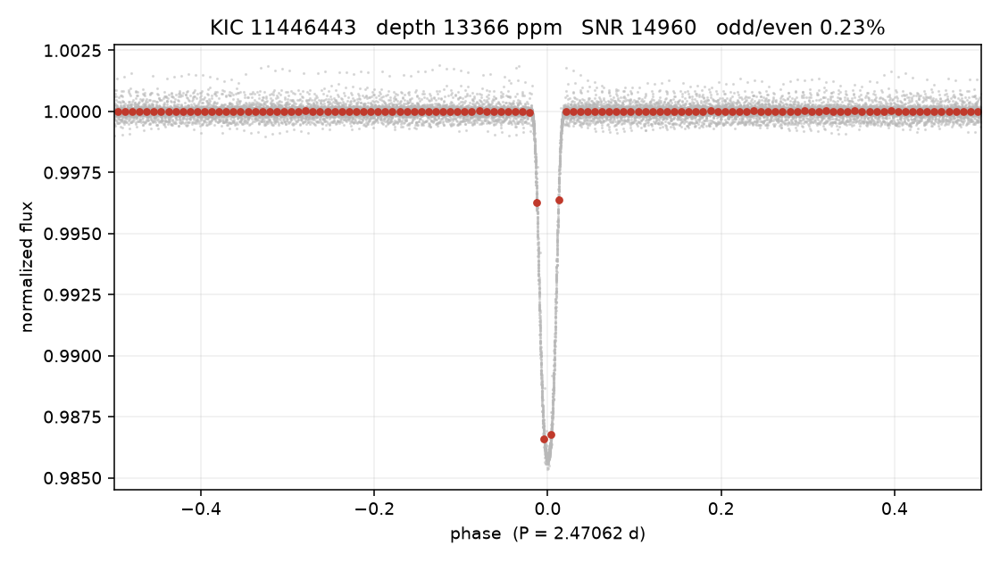
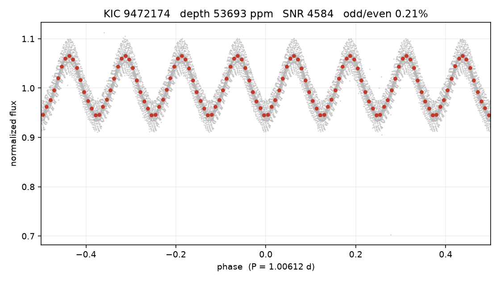

# exo-hunt

批量扫描 Kepler 公开光变曲线的凌星搜寻管线。给定一份 KIC 名单，它对每颗星跑 BLS 周期搜索、测量凌星参数、跑一组假阳性判据，输出一张带指标的打分表，并把候选画成相位折叠图。

为复现业余项目里那种「扫一堆星找凌星」的做法而写，但重点不在跑得多，在于**每一项判据都在有真值的对照集上量过效果**——包括量完发现没用的那些。

## 它做到什么程度

先说结论：**检出凌星很容易，排除假阳性很难。**

校准目标 TrES-2b（KIC 11446443）恢复 P = 2.47062 d，真值 2.47061 d，误差 0.01 分钟；深度 1.337 % 对真值 1.5 %；奇偶一致到 0.23 %。

在 50 颗有 KOI 真值的对照星（25 颗确认行星、25 颗深信号假阳性食双星）加 9 颗 KOI 外的普通星上，不同门槛的实测代价：

| 门槛 | 召回 | 假阳性混过 | 普通星误判 | 输出纯度 |
|---|---|---|---|---|
| SNR>100, sinusoidity<1.5 | 96 % | 19/25 | 0/9 | 56 % |
| **SNR>1000（`default`）** | **92 %** | **19/25** | 0/9 | **55 %** |
| SNR>5000, sinusoidity<1.5 | 80 % | 9/25 | 0/9 | 69 % |
| `strict` 档（见下） | 68 % | 3/25 | 0/9 | **85 %** |

**把门槛从 100 提到 1000 几乎什么也没换到**：召回掉一颗，纯度还低一个百分点。原因是大多数通过形状判据的假阳性 SNR 早就超过 1000 了，卡在这里切不到它们。要动真格得卡到 5000 以上，或者用 `strict` 档。

`strict` 档是 `SNR>8000, sinusoidity<1.5, vingness<0.3, secondary_ratio<0.02`，纯度 85 %、召回 68 %。代价是主动放弃约三分之一的真行星——**适合「只要少量高可信候选」，不适合「一份也别漏」**。

即使 strict 档，5 个里也有近 1 个是假的。都还不到能宣布发现的水平，是「值得下一步人工看」的水平。

单判据的 ROC AUC（越高越好，0.5 等于抛硬币）：

| 判据 | AUC | 需要先验 |
|---|---|---|
| SNRBLS 功率 | 0.779 | 否 |
| depth / koi_depth | 0.704 | 是 |
| 形状（`1/sinusoidity`） | 0.694 | 否 |
| 奇偶深度比 | 0.683 | 否 |
| 周期匹配 KOI | 0.640 | 是 |
| 二次食深度比 | 0.651 | 否 |
| 质心偏移 | 0.648 | 否 |
| V 形度 | 0.578 | 否 |
| 全部相乘 | 0.725 | 混合 |

没有单一判据够用。SNR 单用就基本追平任何组合——因为假阳性样本本身偏暗偏浅，这是选样带来的相关性，不是因果。

## 关键判据：形状

真行星凌星是平底方波；脉动星和接触双星是正弦波。折叠后测凌星外基线的峰谷幅度除以凌星深度（`sinusoidity`），两类差 70–160 倍。

这个判据在 9 颗普通星里挡掉了两颗 SNR 高达 1304 和 4584 的变星——它们本来会是最显眼的假候选。

```
KIC 11446443 (确认行星)  sinusoidity 0.03
KIC 9472174   (变星)     sinusoidity 2.35
KIC 7917485   (变星)     sinusoidity 5.25
```



平底、凌星外干净，是行星的形状。



同一个管线在这颗上给出 SNR 4584、深度 5.4 %、奇偶一致到 0.2 %——但它是正弦的，不是凌星。

## 安装

需要 Python 3.11 和能访问 MAST 的网络。

```bash
python -m venv .venv
UV_LINK_MODE=copy .venv/Scripts/pip install -r requirements.txt
```

`UV_LINK_MODE=copy` 不是可选的：跨文件系统时 uv 默认硬链接，会装出半残的 numpy/scipy。

`run.sh` 先设代理再调 venv 里的解释器。默认指向 `socks5://127.0.0.1:7890`，可以换或关掉：

```bash
./run.sh validate.py                          # 用默认代理
EXO_PROXY=socks5://10.0.0.5:1080 ./run.sh …   # 换一个
EXO_NO_PROXY=1 ./run.sh …                     # 不用代理
```

代理地址写 `socks5://`，不要写 `socks://`——urllib3 不认后者。注意 GitHub 和 MAST 的方向可能相反：本机是 MAST 必须走代理、GitHub 必须直连，`git push` 和 `gh` 记得别继承代理变量。

## 用法

先自检，改过 `detect.py` 之后都该跑一次：

```bash
./run.sh validate.py     # 打印 PASS/FAIL
```

扫描一份名单（CSV 需要 `kepid` 列，`koi_period` 和 `koi_depth` 可选，有的话会算先验判据）：

```bash
./run.sh sweep.py --list data/pos_confirmed.csv --label confirmed --jobs 5
```

结果追加进 `out/sweep.csv`，按 `status == "ok"` 的 kepid 断点续跑，中断了重跑同一条命令即可。`--jobs` 是进程数。

看分布和 AUC：

```bash
./run.sh evaluate.py
```

按门槛切出候选清单（默认 `SNR>1000`，可逐项覆盖，也可以直接指定档位）：

```bash
./run.sh select.py                                  # out/candidates.csv
./run.sh select.py --preset strict                  # 85% 纯度那档
./run.sh select.py --min-snr 3000 --max-vingness 0.5
```

`select.py` 每次都会打印这一刀砍掉了多少召回，不只报留下了什么。

出相位折叠图：

```bash
./run.sh plot.py 11446443 --out docs/figs
```

## 方法

`detect.load_lightcurve` 取 PDCSAP 流量，只用 Kepler 的 `quality == 0` 位掩码，不做 sigma clip。`bls_search` 在对数周期网格上跑 astropy 的 `BoxLeastSquares`，对每个存活峰做局部精修，功率用 `(peak - median) / MAD` 归一化以便跨星比较。然后 `measure` 向外重优化凌星时长测深度，`shape_test` 测形状，`eclipse_shape` 量 V 形度和二次食，`centroid_test` 量质心是否被拽动。

## 踩过的坑

这些每一个都真实发生过，也都在 `validate.py` 里有对应的检查项：

**astropy 的 `compute_stats` 给的 depth 是分数深度乘凌星次数。** 同一颗星不同周期下数值差几十倍，跨星完全不可比。改成自己折叠以后取凌星内外中位数。

**sigma clip 会把凌星本身当离群点剪掉。** TrES-2 的流量散度 0.00176，4σ 是 0.0071，比 0.014 的凌星还浅——一剪就没。只用 quality 位掩码。

**线性周期网格让 2P 谐波系统性获胜。** 长周期端相对步长更粗，2P 反而比真周期更能扛住相位漂移。改对数网格。

**奇偶深度分不开 P 和 2P。** 2P 解只用一半凌星，天然更"干净"，奇偶反而比真周期更一致。正确判据是看相位 0.5 处有没有等深的第二个凌星——有就减半。这个 bug 让 KIC 12020329 报出 14.55 d（真值 7.27504 d，正好 2 倍），修完误差 0.0 分钟。

**BLS 的时长网格总是选最短的一格。** 在 29.4 分钟的 Kepler 采样下只有 2 个点落在凌星里，任何中位数都站不住。`measure` 改成向外扫时长取最深的那个。

**质心检验算出来是 1300σ 却没区分度。** 因为 Kepler 的质心有约 1 像素的低频漂移，而稀释造成的位移只有 0.003 像素。加了 1 天的滑动中位数去趋势才勉强有信号，但 AUC 仍然只有 0.648。

## 局限

诚实列一下，别拿去当成品用：

- **食双星还是漏。** 在宽松门槛下 76 % 的深信号假阳性能混过。V 形度和二次食判据单独用效果都差（AUC 0.578 和 0.651），原因之一是 `measure` 选的是最长最深的 box，把 V 形的翼也框进去了，反而抹平了差别。它们只在 `strict` 档那种高 SNR 子集上配合起来才有边际作用——别指望单独拿 `vingness` 去筛。
- **`strict` 档的 68 % 召回是在 25 颗上量的**，样本小，而且这 25 颗被特意挑成深信号，换成一般的浅信号行星召回只会更低。
- **没有像素级验证。** 正经做法是差分成像或 PRF 拟合确认信号来自目标星而非邻近星，这里只有粗糙的质心位移。
- **底噪样本只有 9 颗**，`keplernames` 表太小。SNR 门槛的实际形状需要更大的随机样本才能定。
- **周期搜索范围写死 1–15 天**，长周期和单次凌星都碰不到。
- **恒星参数一概不看。** 没有半径、没有 logg，深度换算不成行星半径，也不知道宿主是矮星还是巨星。
- **单点失败仍在。** KIC 6392727 报 7.63 d 而真值 4.58352 d，不是整数倍关系，是找错了峰。
- 一个已知的物理限制：与目标星同位置（< 0.4″）的食双星，任何基于光变曲线的判据都分不开。

## 数据

光变曲线来自 MAST 的 Kepler 归档，通过 `lightkurve` 读取，全部公开。对照名单来自 NASA Exoplanet Archive 的 TAP 服务：`cumulative` 表里 `koi_disposition = 'CONFIRMED'` 的取 25 颗当阳性，深信号 `FALSE POSITIVE` 取 25 颗当阴性，`keplernames` 里不在 KOI 目录的取 9 颗当底噪。名单在 `data/` 下。

## 许可

MIT，见 `LICENSE`。
